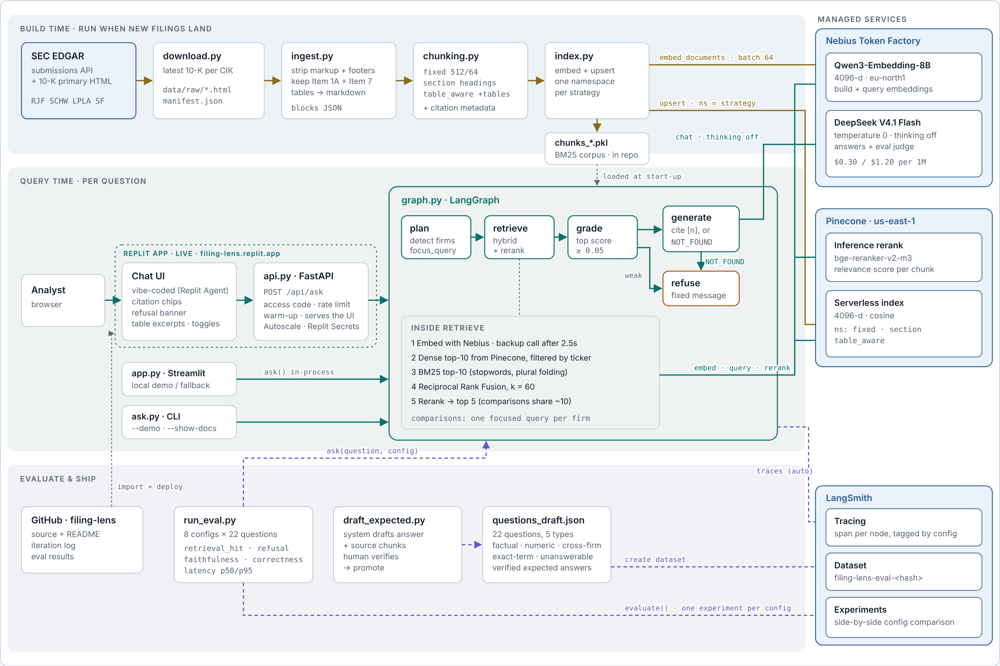
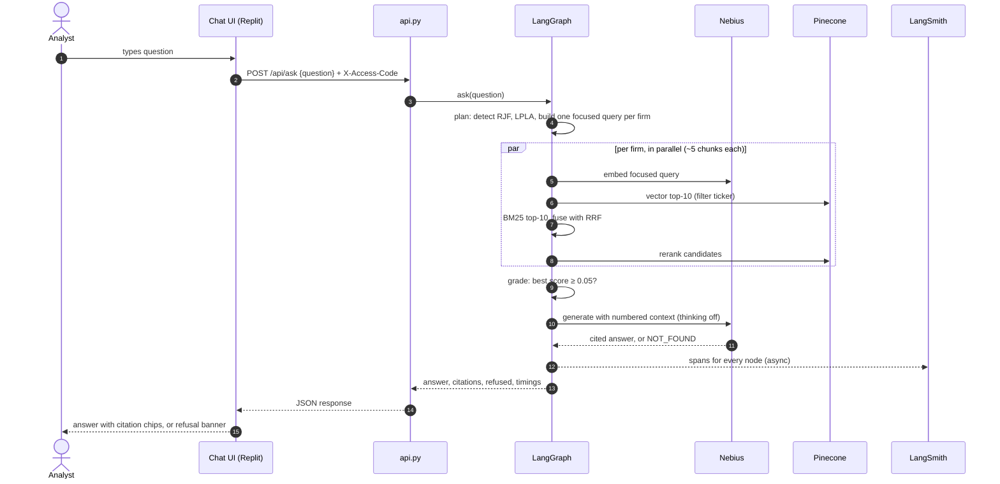
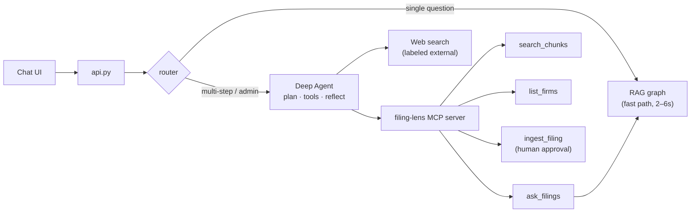

# Filing Lens Architecture

Hybrid RAG over the latest 10-K filings of Raymond James (RJF), Charles Schwab (SCHW), LPL Financial (LPLA) and Stifel (SF), limited to Item 1A (Risk Factors) and Item 7 (MD&A). Every answer is cited to a chunk, or refused. Every run is traced, and each chunking and retrieval configuration is evaluated as its own experiment.

**Status:** built and live. The chat UI and API run as one Replit Autoscale deployment at [filing-lens.replit.app](https://filing-lens.replit.app) (access code required).

---

## System flow

A text version of the diagram above that GitHub renders and that is easy to update in a pull request.

## Request sequence

The happy path for a comparison question such as *"Which firm reported higher net revenues: Raymond James or LPL?"*

---

## Components

| Component | Responsibility | Key choices |
|---|---|---|
| `download.py` | Fetch the latest 10-K per company from EDGAR | SEC-required `User-Agent`, under 10 requests/s, `manifest.json` records filing date and URL for citations |
| `ingest.py` | Turn HTML into clean blocks, keep Items 1A and 7 | Drops page numbers and running headers; tables become markdown so figures keep their row and column labels; section bounds chosen structurally to skip the table of contents |
| `chunking.py` | Three chunking strategies over the same blocks | `fixed` 512/64 tokens; `section` splits on 10-K headings (≤800 tokens, `[CATEGORY > title]` prefix); `table_aware` adds each data table as its own chunk with company/Item/heading context |
| `index.py` | Embed and store | Nebius embeddings in batches of 64; one Pinecone namespace per strategy; same chunks pickled for BM25 |
| `retrieval.py` | Candidate retrieval | Dense (Pinecone, ticker filter) + BM25 (stopwords, plural folding), Reciprocal Rank Fusion (k = 60), Pinecone rerank |
| `graph.py` | LangGraph flow | `plan → retrieve → grade → generate \| refuse`; two refusal gates; per-node timings |
| `run_eval.py` | Evaluation matrix | One LangSmith experiment per config; retrieval hit, refusal correctness, faithfulness, correctness, latency |
| `draft_expected.py` | Ground-truth helper | System drafts an answer with its source chunks; a human verifies before promoting it to `expected_answer` |
| `app.py` | Local chat UI | Streamlit; live config switches, cited excerpts, refusal reason, latency |
| `api.py` | HTTP interface | FastAPI `POST /api/ask`, `/api/health`, `/api/options`; user-entered access code (`X-Access-Code`), per-IP rate limit, warm-up on start; serves the built UI from the same origin |

## Interfaces

| From → To | Interface | Payload | Status |
|---|---|---|---|
| Chat UI → `api.py` | HTTPS `POST /api/ask`, same origin, `X-Access-Code` header typed by the user | `{question, strategy?, retriever?, rerank?}` → `{answer, citations[] (with excerpt), refused, refusal_reason, companies, top_score, timings, config}` | Built |
| `api.py` / `app.py` / `ask.py` → `graph.py` | In-process `ask()` | Question + config in, `RAGState` out | Built |
| retrieve → Nebius | OpenAI-compatible embeddings (`langchain-nebius`) | One 4096-d vector per (sub-)query | Built |
| retrieve → Pinecone index | Vector query, top-10, `ticker` filter, namespace = strategy | Chunk text + `ticker`, `item`, `heading`, `kind`, `chunk_id` | Built |
| retrieve → Pinecone rerank | Inference API, `bge-reranker-v2-m3`, truncate END | Relevance score per candidate | Built |
| generate → Nebius chat | Chat completions, temperature 0, `chat_template_kwargs.thinking=false` | Numbered context → cited answer or `NOT_FOUND` | Built |
| `graph.py` → LangSmith | Tracing from environment variables | Span per node and retrieval stage, tagged by config | Built |
| `run_eval.py` → LangSmith | `evaluate()` on a versioned dataset | One experiment per config, six feedback keys | Built |
| `download.py` → EDGAR | HTTPS GET with SEC `User-Agent` | Filing index JSON, 10-K HTML | Built |
| `index.py` → Nebius / Pinecone | Embeddings (batch 64), upsert by `chunk_id` | Vectors + citation metadata into 3 namespaces | Built |

## Deployment

| Piece | Where | Secrets |
|---|---|---|
| Source, chunk files, eval results | GitHub | none (`.env` is git-ignored) |
| `api.py` + chat UI | Replit app imported from GitHub, Autoscale deployment with 1 machine at [filing-lens.replit.app](https://filing-lens.replit.app) ([setup](REPLIT_SETUP.md)) | Replit Secrets: Nebius, Pinecone, LangSmith keys, `APP_ACCESS_CODE` |
| Vectors, rerank | Pinecone serverless, AWS us-east-1 | `PINECONE_API_KEY` |
| Embeddings, generation, eval judge | Nebius Token Factory (embeddings served from eu-north1) | `NEBIUS_API_KEY` |
| Traces, dataset, experiments | LangSmith | `LANGSMITH_API_KEY` |

## Design decisions

**Two refusal gates.** `grade` refuses when nothing relevant is retrieved. `generate` returns `NOT_FOUND` when retrieved text looks relevant but doesn't answer the question. The second gate caught *"Morgan Stanley's wealth management revenues"*, which scored 0.86 on rerank because other firms' wealth-management passages look similar.

**Namespaces as experiments.** Each chunking strategy is a namespace in one Pinecone index, so every configuration searches the same corpus and comparisons stay clean.

**Per-firm retrieval for comparisons.** Each firm gets a focused query with the other firm's name removed, a ticker filter, and a share of a ~10-chunk budget. With a fixed 3 per firm, RJF's consolidated revenue table ranked 4th behind segment tables and was missed.

**Hybrid over keyword-only.** BM25 alone failed the RJF vs LPL revenue question: numeric tables share few words with the question. Dense retrieval recovers them; BM25 still helps on exact terms such as program names.

**Latency.** The chat model emitted hidden reasoning tokens even though the catalog lists none; disabling it (`chat_template_kwargs.thinking=false`) brought demo questions to 1.9–6.4s end to end. On Replit three more fixes followed, each found from the per-step timings the API returns:

- Warm-up runs one real retrieval per namespace, not just client set-up: the first live answer went from 37.1s to 2.8s.
- Comparisons embed each firm's query one at a time before the parallel search: concurrent calls to the shared Nebius embedding endpoint took ~9s each. 17.9s → 4.6s.
- Embedding calls are hedged: if Nebius hasn't answered in 2.5s, a backup request goes out and the first answer wins. LangSmith showed `embed_query` at 10.6s of a 12.9s question while Pinecone, rerank and generation stayed fast. When both requests stall, the spike remains; a dedicated endpoint would remove it.

**Relevance threshold 0.05.** At 0.15, "What does LPL say about cybersecurity risk?" was refused although the right chunks ranked 2nd and 5th: the reranker scored them 0.11 because the filing says "security risks" and "cyber-attack". At 0.05 the eval's correctness rose from 0.72 to 0.81 with refusal accuracy unchanged, since the generation gate still refuses unanswerable questions.

---

## Roadmap

### Freshness and new firms

Today the corpus is the latest 10-K for four firms, refreshed by rerunning the build pipeline. Making ingestion an admin capability needs:

| Change | Why |
|---|---|
| Company registry as data | `COMPANIES` and name aliases are in code; new firms need a ticker → CIK lookup (SEC `company_tickers.json`) and stored aliases |
| 10-Q support | Quarterly reports use different sections (MD&A is Part I Item 2; risk-factor updates are Part II Item 1A) |
| Filing version metadata | `form` and `period` on every chunk; default to the latest filing, allow period comparisons |
| Per-firm re-index | Delete one firm's vectors by metadata filter, upsert the new filing |
| Durable keyword index | Move BM25 from local pickles to Pinecone sparse vectors or object storage, so hosted deployments don't lose it |
| Background jobs + admin auth | Embedding a filing takes minutes and spends credits: run as a job with status, behind a separate admin credential and a spend cap |

Target refresh: within one business day of a new 10-K or 10-Q on EDGAR.

### Agentic layer (Week 3: MCP + Deep Agents)

- **Same core, two adapters.** The RAG graph stays the domain service; HTTP serves the UI and an MCP server exposes it as tools to agents and any MCP client.
- **Fast path stays.** A router sends single questions straight to the graph; only multi-step research ("compare all four firms' rate sensitivity and draft a summary") and admin actions go through the agent, which costs several model calls per request.
- **Grounding rule.** Filing answers cite chunks. Web results are labeled as external and kept separate, so "not in the filings" refusals keep their meaning.
- **Approval for side effects.** `ingest_filing` changes the index and spends credits, so it pauses for human confirmation.
- **Unchanged contract.** The UI keeps calling `POST /api/ask`; the agent sits behind it.

See the [iteration log in the README](../README.md#iteration-log) for how each of these was found.
