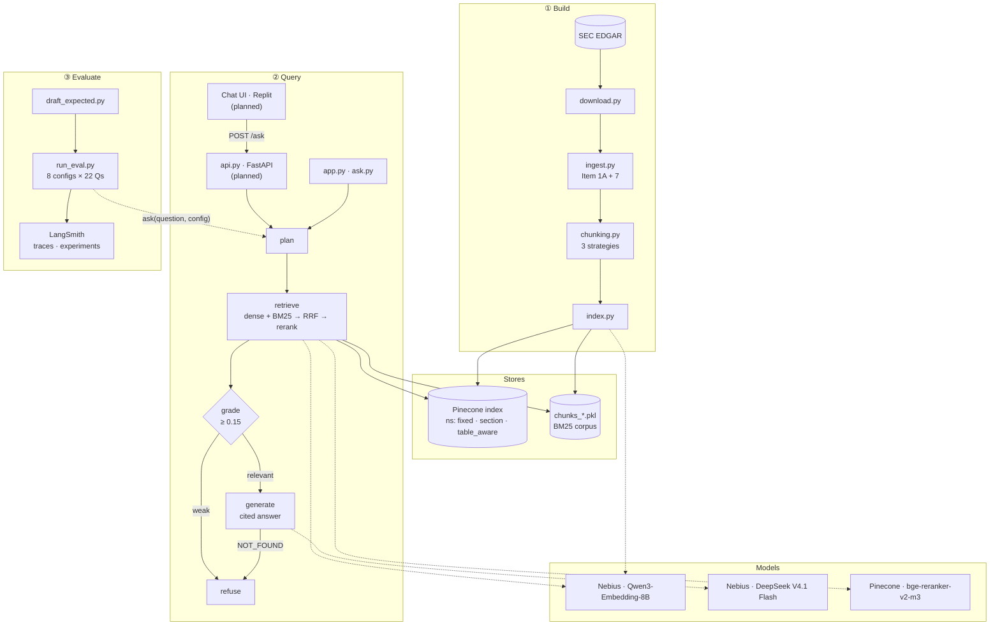
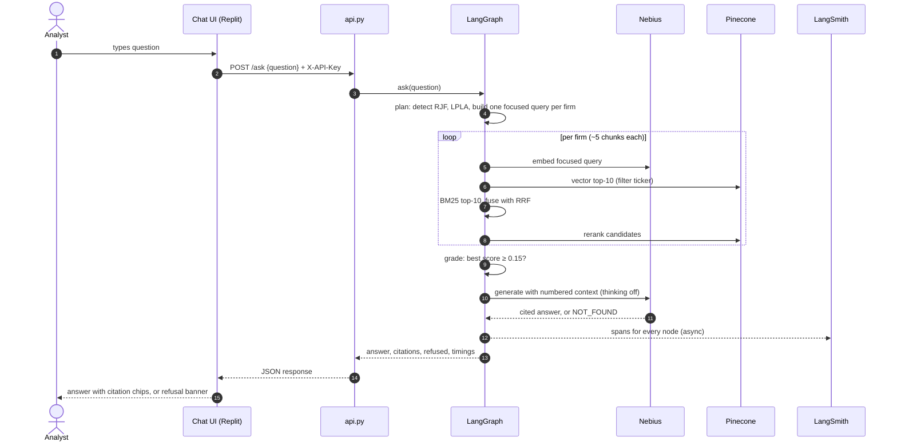

# Filing Lens Architecture

Hybrid RAG over the latest 10-K filings of Raymond James (RJF), Charles Schwab (SCHW), LPL Financial (LPLA) and Stifel (SF), limited to Item 1A (Risk Factors) and Item 7 (MD&A). Every answer is cited to a chunk, or refused. Every run is traced, and each chunking and retrieval configuration is evaluated as its own experiment.

**Status:** everything is built except the FastAPI service and the Replit chat UI, which are marked *planned*.

---

## System flow

A text version of the diagram above that GitHub renders and that is easy to update in a pull request.

## Request sequence

The happy path for a comparison question such as *"Which firm reported higher net revenues: Raymond James or LPL?"*

---

## Components

| Component | Responsibility | Key choices |
|---|---|---|
| `download.py` | Fetch the latest 10-K per company from EDGAR | SEC-required `User-Agent`, under 10 requests/s, `manifest.json` records filing date and URL for citations |
| `ingest.py` | Turn HTML into clean blocks, keep Items 1A and 7 | Drops page numbers and running headers; tables become markdown so figures keep their row and column labels; section bounds chosen structurally to skip the table of contents |
| `chunking.py` | Three chunking strategies over the same blocks | `fixed` 512/64 tokens; `section` splits on 10-K headings (≤800 tokens, `[CATEGORY > title]` prefix); `table_aware` adds each data table as its own chunk with company/Item/heading context |
| `index.py` | Embed and store | Nebius embeddings in batches of 64; one Pinecone namespace per strategy; same chunks pickled for BM25 |
| `retrieval.py` | Candidate retrieval | Dense (Pinecone, ticker filter) + BM25 (stopwords, plural folding), Reciprocal Rank Fusion (k = 60), Pinecone rerank |
| `graph.py` | LangGraph flow | `plan → retrieve → grade → generate \| refuse`; two refusal gates; per-node timings |
| `run_eval.py` | Evaluation matrix | One LangSmith experiment per config; retrieval hit, refusal correctness, faithfulness, correctness, latency |
| `draft_expected.py` | Ground-truth helper | System drafts an answer with its source chunks; a human verifies before promoting it to `expected_answer` |
| `app.py` | Local chat UI | Streamlit; live config switches, cited excerpts, refusal reason, latency |
| `api.py` *(planned)* | HTTP interface | FastAPI `POST /ask`, API key, CORS; deployed on Replit |

## Interfaces

| From → To | Interface | Payload | Status |
|---|---|---|---|
| Chat UI → `api.py` | HTTPS `POST /ask`, `X-API-Key`, CORS | `{question, strategy?, retriever?, rerank?}` → `{answer, citations[], refused, refusal_reason, timings}` | Planned |
| `api.py` / `app.py` / `ask.py` → `graph.py` | In-process `ask()` | Question + config in, `RAGState` out | Built |
| retrieve → Nebius | OpenAI-compatible embeddings (`langchain-nebius`) | One 4096-d vector per (sub-)query | Built |
| retrieve → Pinecone index | Vector query, top-10, `ticker` filter, namespace = strategy | Chunk text + `ticker`, `item`, `heading`, `kind`, `chunk_id` | Built |
| retrieve → Pinecone rerank | Inference API, `bge-reranker-v2-m3`, truncate END | Relevance score per candidate | Built |
| generate → Nebius chat | Chat completions, temperature 0, `chat_template_kwargs.thinking=false` | Numbered context → cited answer or `NOT_FOUND` | Built |
| `graph.py` → LangSmith | Tracing from environment variables | Span per node and retrieval stage, tagged by config | Built |
| `run_eval.py` → LangSmith | `evaluate()` on a versioned dataset | One experiment per config, six feedback keys | Built |
| `download.py` → EDGAR | HTTPS GET with SEC `User-Agent` | Filing index JSON, 10-K HTML | Built |
| `index.py` → Nebius / Pinecone | Embeddings (batch 64), upsert by `chunk_id` | Vectors + citation metadata into 3 namespaces | Built |

## Deployment

| Piece | Where | Secrets |
|---|---|---|
| Source, chunk files, eval results | GitHub | none (`.env` is git-ignored) |
| `api.py` + chat UI *(planned)* | Replit app, imported from GitHub; Replit Deployment | Replit Secrets: Nebius, Pinecone, LangSmith keys, API key |
| Vectors, rerank | Pinecone serverless, AWS us-east-1 | `PINECONE_API_KEY` |
| Embeddings, generation, eval judge | Nebius Token Factory (embeddings served from eu-north1) | `NEBIUS_API_KEY` |
| Traces, dataset, experiments | LangSmith | `LANGSMITH_API_KEY` |

## Design decisions

**Two refusal gates.** `grade` refuses when nothing relevant is retrieved. `generate` returns `NOT_FOUND` when retrieved text looks relevant but doesn't answer the question. The second gate caught *"Morgan Stanley's wealth management revenues"*, which scored 0.86 on rerank because other firms' wealth-management passages look similar.

**Namespaces as experiments.** Each chunking strategy is a namespace in one Pinecone index, so every configuration searches the same corpus and comparisons stay clean.

**Per-firm retrieval for comparisons.** Each firm gets a focused query with the other firm's name removed, a ticker filter, and a share of a ~10-chunk budget. With a fixed 3 per firm, RJF's consolidated revenue table ranked 4th behind segment tables and was missed.

**Hybrid over keyword-only.** BM25 alone failed the RJF vs LPL revenue question: numeric tables share few words with the question. Dense retrieval recovers them; BM25 still helps on exact terms such as program names.

**Latency.** The chat model emitted hidden reasoning tokens even though the catalog lists none; disabling it (`chat_template_kwargs.thinking=false`) and warming clients at start-up brought demo questions to 1.9–6.4s end to end. The largest remaining cost is the cross-region embedding call (Nebius eu-north1, Pinecone us-east-1).

See the [iteration log in the README](../README.md#iteration-log) for how each of these was found.
